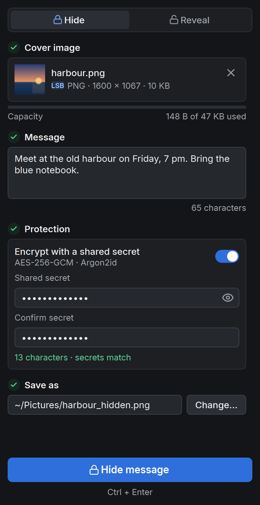
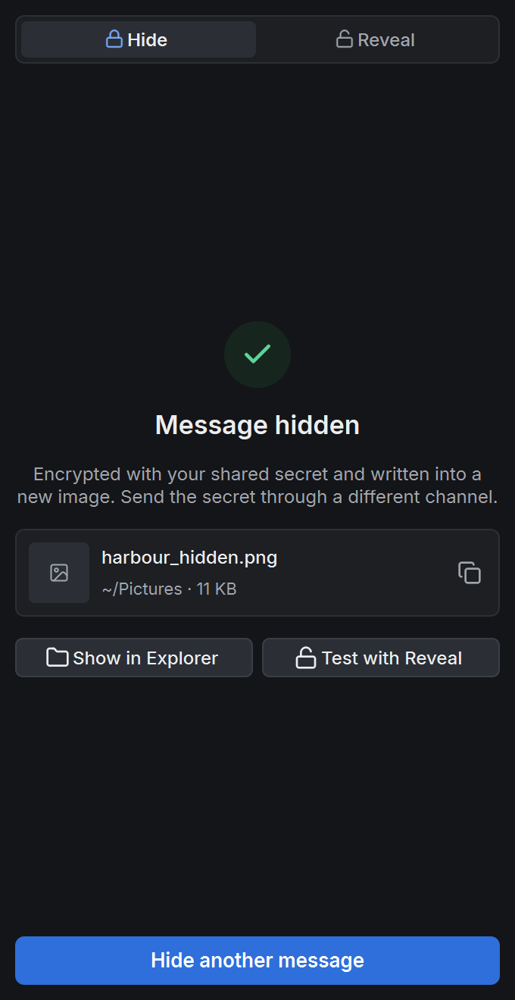
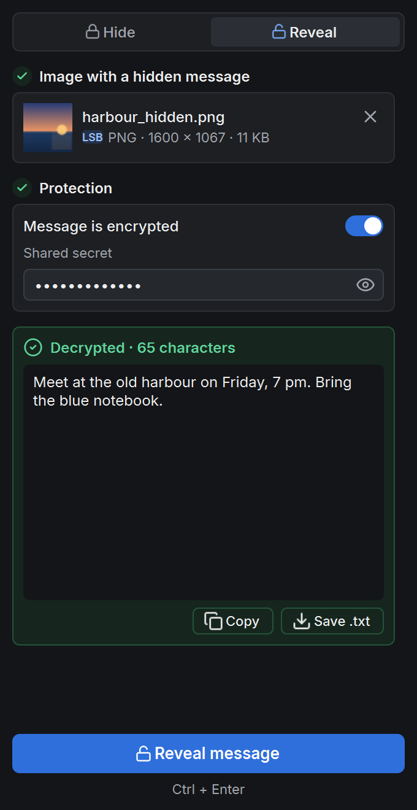
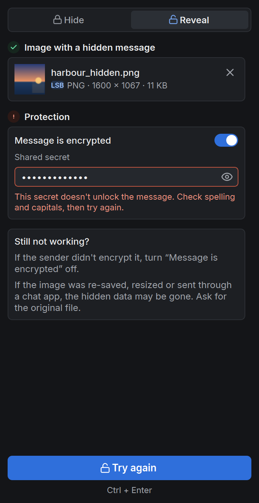

<p align="center">
  
</p>

<h1 align="center">PySteg</h1>

<p align="center">
  <a href="https://github.com/kisscool-fr/pysteg/actions/workflows/ci.yml"></a>
  <a href="https://github.com/kisscool-fr/pysteg/actions/workflows/security.yml"></a>
  <a href="https://github.com/kisscool-fr/pysteg/releases/latest"></a>
  <a href="LICENSE"></a>
</p>

<p align="center">
  
  <a href="https://github.com/astral-sh/uv"></a>
  <a href="https://github.com/astral-sh/ruff"></a>
  <a href="https://microsoft.github.io/pyright/"></a>
  <a href="https://github.com/PyCQA/bandit"></a>
  <a href="https://github.com/gitleaks/gitleaks"></a>
</p>

<p align="center">
  A simple GUI for steganography: hide and reveal secret messages in images,<br>
  with optional AES-256-GCM encryption and Argon2id key derivation.
</p>

Built as a replacement for [Steganozorus](https://thomasnerrant.com/steganozorus.htm) © 2002 – [Thomas Nerrant](https://thomasnerrant.com/).

> **Warning:** PySteg is still under active development. Backward compatibility for hidden text is not guaranteed before version 1.0 (messages encoded with an earlier release may not be readable after an upgrade).

## Sponsor

If you find this project useful, consider [buying me a coffee](https://www.buymeacoffee.com/kisscool).

## Features

- **Hide and reveal messages** in image files using LSB or EXIF steganography
- **AES-256-GCM encryption** with Argon2id key derivation from a shared secret
- **Plain text mode** to hide a message without encryption (useful for testing or low-risk payloads)
- Desktop GUI built with PyQt6

### Supported media formats

PySteg uses [Stegano](https://github.com/cedricbonhomme/Stegano) for steganography.

| Format | Technique | Support |
|--------|-----------|---------|
| PNG, BMP | LSB (least significant bit) | ✅ |
| JPEG, TIFF | EXIF header | ✅ |
| WAV | LSB | 🔜 |
| PNG (grayscale) | RDH (reversible histogram shifting) | 🔜 |
| RGB images (PNG, BMP, JPEG, …) | RED (red channel) | 🔜 |

✅ supported today

🔜 available in Stegano, planned for PySteg integration

## Requirements

- Python 3.13
- [uv](https://docs.astral.sh/uv/) (recommended) or pip
- [just](https://github.com/casey/just) (optional, for recipe commands)

## Installation

First-time setup (creates a virtual environment with the Python version from `.python-version`):

```bash
just init
just install
```

Or with uv directly:

```bash
uv sync
```

## Usage

```bash
just run
```

Or:

```bash
uv run -m app
```

1. Choose **Hide** or **Reveal** mode.
2. Drop a cover image on the window, or click **Browse…**. PySteg shows its format, the technique it will use (LSB or EXIF) and how much text it can hold.
3. In hide mode, type the message; the capacity meter shows how much of the image it uses.
4. Enter a shared secret (at least 8 characters, typed twice when hiding), or turn **Encrypt with a shared secret** off to store plain text.
5. In hide mode, check the output path (pre-filled next to the cover image) or click **Change…**.
6. Click the action button or press Ctrl+Enter (⌘+Return on macOS). The button stays disabled, with the reason underneath, until everything is valid.
7. After hiding, open the output folder or click **Test with Reveal** to check the new image. After revealing, **Copy** the message or save it as a `.txt` file.

See [docs/design/DESIGN.md](docs/design/DESIGN.md) for the reasoning behind the interface.

## Development

Common tasks via [just](https://github.com/casey/just):

```bash
just test      # run pytest
just format    # lint and format with ruff
just typing    # type-check with pyright
just ci        # full local CI pipeline
```

List all recipes with `just --list`.

## Building a binary

Build a standalone executable with [PyInstaller](https://pyinstaller.org/):

```bash
just build         # build for the host OS, version from pyproject.toml
just build 0.4.0   # override the version label
```

The output is written to `dist/`:

- **Windows** — `pysteg-<version>-windows.exe` (single file)
- **Linux** — `pysteg-<version>-linux` (single file)
- **macOS** — `pysteg-<version>-macos.zip` (a zipped `PySteg.app` bundle)

> [!NOTE]
> PyInstaller cannot cross-compile: a build always targets the OS it runs on.
> That is why each release binary is built on its own runner. Releases attach
> binaries for all three platforms automatically (see
> `.github/workflows/release.yml`).

## Screenshots

PySteg looks the same on Windows, macOS and Linux.

| Hide | Message hidden |
| :---: | :---: |
|  |  |
| **Reveal** | **Wrong secret** |
|  |  |

## Roadmap

- [x] Choose output file name
- [ ] Add pane to choose encryption / diffusion algorithm
- [ ] Add support for more encryption algorithms
- [ ] Add support for keyfiles
- [ ] Audio and video support, drag & drop
- [ ] Deniability support
- [ ] Self-destructing messages (one-time reveal that restores the original cover)
- [ ] More languages
- [x] Binary release
- [ ] Code signing
- [x] Design improvements

> [!NOTE]
> Release binaries are currently **unsigned**. Planned signing per platform:
>
> - **Linux** — no code signing needed; publishing `SHA256` checksums for verification is enough.
> - **Windows** — free Authenticode signing via the [SignPath Foundation](https://signpath.org/) OSS tier (HSM-backed, integrates with GitHub Actions).
> - **macOS** — requires an Apple Developer Program membership ($99/yr) to sign with a *Developer ID Application* certificate and notarize the `.app`. Until then, bypass Gatekeeper with right-click → **Open** (or `xattr -d com.apple.quarantine <file>`).

## License

[GPL-3.0-or-later](LICENSE)

## Community

- [Contributing](CONTRIBUTING.md) — development setup, code style, and pull request process
- [Security policy](SECURITY.md) — how to report vulnerabilities privately
- [Code of conduct](CODE_OF_CONDUCT.md)

## Credits

[Sébastien B](https://github.com/kisscool-fr/)
